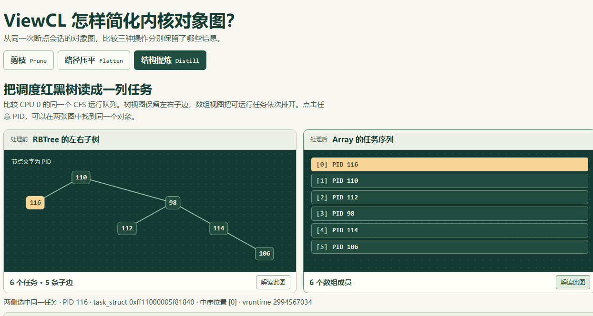

# Visualinux 论文复现与课堂演示

我们在 Windows 上用 QEMU 运行 Linux 6.1.25，用 GDB 从暂停的内核中采集对象，再用 Visualinux v1.0 生成教材图、比较 ViewCL 的三种操作，并检验 ViewQL 的查询效果。这个仓库保存了课堂演示、实验结果、核验程序和小组编写的实验代码。[EuroSys 2025 论文](https://doi.org/10.1145/3689031.3696095) · [作者的 v1.0 归档](https://doi.org/10.5281/zenodo.13710732)

## 克隆到本地并打开演示

需要 Git 和一个现代浏览器。查看演示时无需安装 Python、Node.js、QEMU 或 WSL。

1. 选择一个用于保存实验的文件夹，在该文件夹中打开 Windows PowerShell。仓库是公开的，组员无需 GitHub 账号即可克隆。
2. 运行以下三条命令。

   ```powershell
   git clone https://github.com/ZZJ1977/visualinux-replication.git
   cd visualinux-replication
   Start-Process .\demo\index.html
   ```

3. 浏览器应显示「内核对象图谱」、Linux 6.1.25 和 CFS 运行队列。按 **1、2、3** 切换「教科书案例」「ViewCL 建图」「ViewQL 查询」。课堂投影时可点击「投屏模式」。

macOS 和 Linux 同样可以使用前两条命令，然后用浏览器打开 `demo/index.html`。没有安装 Git 的组员可在仓库页面选择 **Code → Download ZIP**，解压后双击同一文件。以后要更新演示，在克隆目录运行 `git pull --ff-only`，再刷新浏览器。



## 第一次打开可以看什么

| 打开位置 | 可以动手验证的问题 |
| --- | --- |
| **教科书案例 → CFS 运行队列** | 在 CPU 0 的红黑树里找到一个 PID。图中的任务来自客体在断点处的内存快照。图集可浏览 20 个视图，IPC 一图同时展示信号量与消息队列，对应论文表 2 的 21 个条目。 |
| **ViewCL 建图** | 在 Prune 中比较同一任务的 10 个与 4 个字段。在 Flatten 中沿文件描述符跟到同一套接字。在 Distill 中点一个 PID，核对树和序列中高亮的是否为同一任务。 |
| **ViewQL 查询** | 点击「收起无处理程序的 IRQ」。16 个中断描述符中有 8 个的 `action` 为空。试着反选，再恢复全部。页面在内嵌的同一份快照上执行查询。 |
| **教科书案例 → 补充实验 → 套接字队列** | 发出两个数据报再依次读取，接收队列长度从 **0 → 2 → 0**。中间帧中两个包的长度分别为 5 和 11 字节。可以在这里观察小组自写程序如何改变内核状态。 |

## 哪些结果与论文对得上

| 论文项目 | 本组结果 |
| --- | --- |
| 表 2，教材结构 | 20 个归档视图在同一次断点会话中各采集三轮，60 次均通过根对象与代表性字段核验。表中各图的代码行数受共享定义计数方式影响，未逐项重得。 |
| 表 3，ViewQL | 10 个目标均逐对象核对。按归档图属性，原版查询 7 项符合。进程树、块设备、文件映射有明确差异。若把「大页索引」定为至少 64 页，页缓存查询还多选了 6 个空索引，严格符合的为 6 项。64 页是本组设定的阈值。 |
| 表 4，QEMU | 20 个视图各测三次，单图抽取耗时 17.9–530.4 ms。进程树三轮均值为 119.3 ms，论文为 59.6 ms；块设备图为 80.6 ms，论文为 80.3 ms。计时覆盖抽取阶段，组员打开离线网页时看到的是已保存的结果。 |

我们没有实体 Raspberry Pi 400 的 KGDB 测量，也没有用原版 DeepSeek-V2 重跑论文的查询生成过程。论文中的两个漏洞诊断案例只做了文献核对。[作者报告的实验范围](https://cs.nju.edu.cn/changxu/1_publications/25/EUROSYS25.pdf)

## 检查结果与重新运行实验

已经安装 Python 3.10 或更新版本的组员可以在仓库根目录运行下面的命令，核验随仓库分发的结果。

```powershell
python reproduce/verify.py
```

- [实验数据与判据](results/README.md)说明每份数据的来源、每列计时的含义，以及原版查询和补充核验的区别。
- [实验代码与复跑步骤](reproduce/README.md)列出自写负载、ViewCL 源码、所需的客体环境，以及如何重新触发和观察内核状态。
- [演示软件来源与许可](demo/THIRD-PARTY.txt)列出离线页面所使用的第三方组件。
